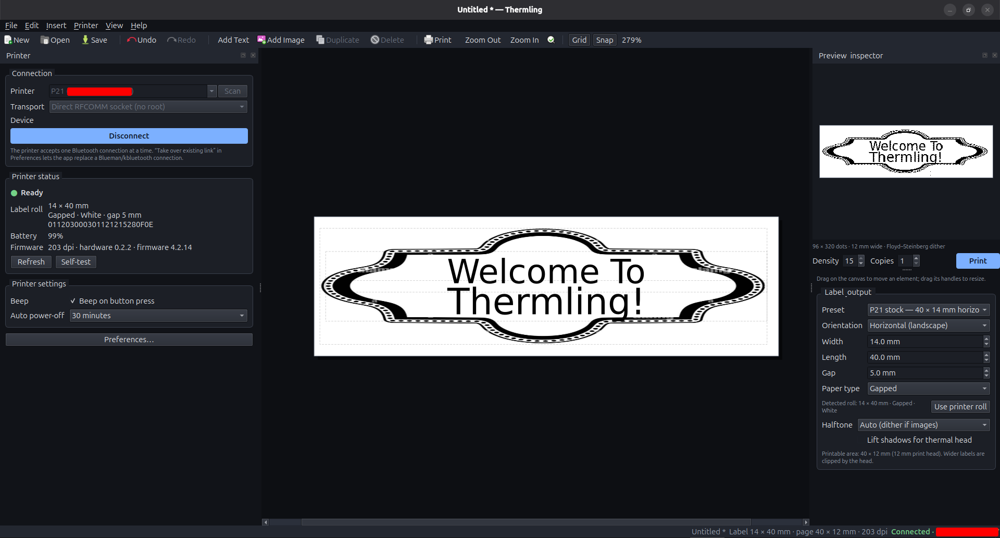
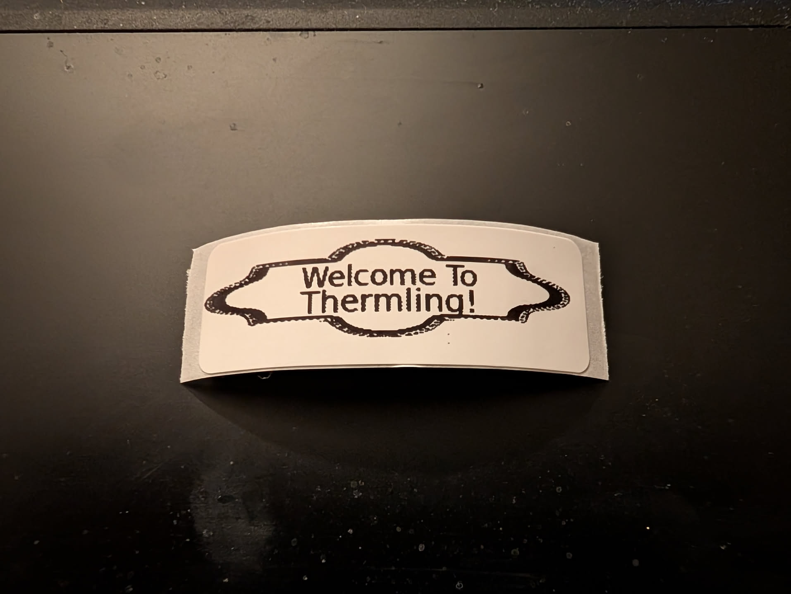
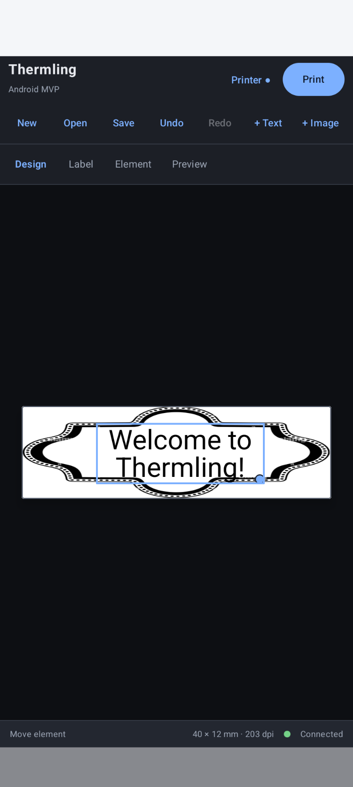
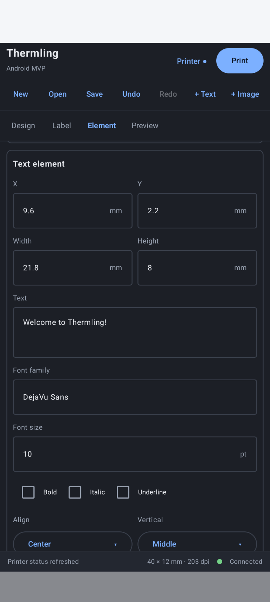

# Thermling

Thermling is a label composer for the Nelko P21/P22 thermal printer, built with
Compose Multiplatform. The shared Kotlin model, protocol, state, and UI run as a
Linux desktop app and as an Android app.

## Screenshots

### Linux desktop

| Desktop app | Printed label |
|:---:|:---:|
|  |  |

### Android

| Android app | Android app |
|:---:|:---:|
|  |  |

## What works in this MVP

- 14 × 40 mm P21 stock by default, with the 12 mm print-head width cap.
- Vertical and horizontal page layouts; horizontal labels are rotated into the
  printer's fixed head orientation and rotated back for the preview.
- Text and embedded PNG images, drag-to-move, resize handle, alignment, styling,
  and line spacing.
- Presets, manual dimensions, paper style, halftone mode, thermal correction,
  print density, copies, and printer-reported DPI.
- Undo/redo with one history entry per drag/resize gesture.
- Schema-v2 document save/open; schema-v1 documents load with defaults.
- Printer status, configuration, battery, label-roll tag, and self-test queries.
- Print flow with a FIFO print queue in the shared client layer.
- Demo printer backend for trying the full UI and print flow without hardware.
- Linux transports: direct RFCOMM socket over a raw Bluetooth socket (no root
  and no `/dev/rfcomm` needed, the default), BlueZ `rfcomm` plus a serial device,
  or an existing serial device such as `/dev/rfcomm0`.
- Bluetooth device scanning in the printer dialog, using BlueZ `bluetoothctl`, so
  the printer can be selected instead of typing its address.
- Android app using the same shared editor, with a wide three-pane layout on
  tablets and a tabbed design/label/element/preview layout on phones.
- Android direct Bluetooth SPP transport through the platform `BluetoothSocket`
  API; no root, JNA, `/dev/rfcomm`, or serial-device access is needed.
- Android classic Bluetooth discovery merged with the bonded-device list, so a
  sleeping printer stays selectable after it has been paired once.
- Android Storage Access Framework for opening/saving labels and picking images,
  with settings stored in `SharedPreferences`.
- Dark/light OS theme with a white label page in both themes.

The bitmap preview is the authoritative output. The on-canvas text layout is an
approximation because the printer's font rasteriser differs from AWT/Compose.

## Requirements

- JDK 17 or newer on `JAVA_HOME` or `PATH`.
- Linux desktop session (X11 or Wayland/XWayland) for the desktop app.
- For desktop hardware printing: BlueZ and a paired P21/P22. The default direct
  socket backend needs no root and no serial-device access; the `rfcomm`/serial
  backends need access to the RFCOMM device (usually the `dialout` group).
- For Android: Android 8.0 (API 26) or newer, Android SDK platform 35 and build
  tools 37.0.0, and `ANDROID_HOME` pointing at the SDK. A paired P21/P22 is
  needed only for hardware printing.
- The Gradle wrapper downloads the remaining build dependencies.

## Run

```bash
./gradlew run
```

If your shell does not select a JDK with a compiler:

```bash
JAVA_HOME=/path/to/jdk-17 ./gradlew run
```

Select **Printer… → Backend → Demo printer (no hardware)** to exercise connect,
status, battery, preview, and print without a printer.

For real hardware, pair the printer first:

```bash
bluetoothctl
# pair E4:53:A2:5F:F1:E7   (example address)
```

Then open **Printer…**, leave **Backend** on **Direct RFCOMM socket (no root)**,
click **Scan for devices**, and select the printer from the list. The scan runs
`bluetoothctl --timeout 6 --monitor scan on` and merges the results with
`bluetoothctl devices`, so the last-known printer stays selectable while it is
asleep. Likely printers are listed first. Press **Connect** after selecting one:
Thermling opens RFCOMM channel 1 directly through a Bluetooth socket, with no
root privileges and no `/dev/rfcomm` tty.

If direct sockets are unavailable, choose **rfcomm helper + serial device**.
Thermling then starts `rfcomm connect` and opens the configured serial device.
Alternatively create the serial device outside the app and choose **Existing
serial device**, or type an address manually if scanning is unavailable.

Scanning requires BlueZ's `bluetoothctl`, an enabled Bluetooth adapter, and a
printer that is awake and nearby. On systems where the adapter is blocked by
rfkill or the user cannot access BlueZ, the dialog reports the scan error and the
manual address field remains available.

## Run on Android

Pair the printer in Android Bluetooth settings first (**Settings → Bluetooth**).
Then build and install the debug APK:

```bash
export ANDROID_HOME=/path/to/android-sdk
JAVA_HOME=/path/to/jdk-17 ./gradlew assembleDebug
adb install -r build/outputs/apk/debug/thermling-0.3.0-debug.apk
```

Release builds are signed only when a local signing config is present. Create
`$HOME/.config/thermling/keystore.properties` (or point
`THERMLING_KEYSTORE_PROPERTIES` at it) with `storeFile`, `storePassword`,
`keyAlias`, and `keyPassword`. Without it, `assembleRelease` produces an
unsigned APK that Android refuses to install. Because a release signed with a
different key cannot update a debug installation, uninstall `com.thermling`
first when switching between them.

On first launch Thermling asks for **Nearby devices** permission on Android 12+
(`BLUETOOTH_SCAN` and `BLUETOOTH_CONNECT`). Android 8–11 use location permission
for Bluetooth discovery. If the permission was denied, enable it under
**Settings → Apps → Thermling → Permissions** and try again. On Android 12+,
`BLUETOOTH_SCAN` is declared with `neverForLocation`, so scanning does not need
location access.

Open **Printer…**, keep **Bluetooth printer (SPP)**, tap **Scan for devices**, and
select the printer. The scan combines new classic-Bluetooth discoveries with the
bonded-device list, and likely printers are listed first. Press **Connect** to
open the SPP socket.

Labels are opened and saved through the system file picker. Thermling keeps
persistable read/write access to the selected document, so **Save** can write back
to the same file later without reopening it. Image elements are copied into the
document as PNG data, so the label remains self-contained.

## Test and build

```bash
# Shared logic and desktop tests (76 tests)
DISPLAY= WAYLAND_DISPLAY= ./gradlew desktopTest

# Android JVM unit tests (49 shared tests, no device/emulator needed)
ANDROID_HOME=/path/to/android-sdk ./gradlew testDebugUnitTest

# Full build and desktop distributable
ANDROID_HOME=/path/to/android-sdk DISPLAY= WAYLAND_DISPLAY= ./gradlew build createDistributable
./gradlew packageDeb                # or packageRpm
./gradlew packageLinuxAppImage      # portable Linux .AppImage
```

`packageLinuxAppImage` wraps the jpackage app image in a real `.AppImage` at
`build/compose/binaries/main/appimage/Thermling-<version>-<arch>.AppImage`.
The first run downloads `appimagetool` into `~/.cache/thermling`; its AppImage
bundles `mksquashfs`, so no system packages are required. Set `APPIMAGETOOL` to
use an existing tool instead.

Note that Compose's built-in `packageAppImage` task only creates the unpacked
jpackage app-image directory (`build/compose/binaries/main/app/Thermling/`).
Use `packageLinuxAppImage` when you need a single portable file.

The tests cover protocol framing and parsing, document serialization, transport
behavior, the renderer's packed bitmap and landscape rotation, state/undo/print
flow, and the demo transport. Shared tests also cover the extracted monochrome
pixel math (threshold boundary, thermal correction, bit packing, quarter-turn
rotation) and Bluetooth address normalization, little-endian address bytes, and
printer-first device sorting. Transport tests cover the JNA/libc RFCOMM socket,
including address byte order, framing, timeouts, disconnects, and connection
errors. The BlueZ scanner tests cover ANSI-colored `bluetoothctl` output,
device-list merging, deduplication, blank names, and printer-first ordering.
Compose UI tests also drive the real toolbar and printer dialog: adding text,
opening the dialog from both entry points, scanning and selecting a Bluetooth
device, reporting scan failures, connecting to the demo backend, refreshing
status, and printing. They run headless and do not require a display, Bluetooth
adapter, or printer. The Android JVM suite runs the same shared tests with a
headless bitmap stub; hardware Bluetooth and SAF behavior require a device.

An optional hardware smoke test queries the printer's status over a real direct
socket when a MAC address is supplied:

```bash
./gradlew desktopTest -Dthermling.btMac=E4:53:A2:5F:F1:E7 \
  --tests 'com.thermling.RfcommSocketTransportTest.hardwarePrinterAnswersStatusWhenConfigured'
```

## Project layout

```text
src/commonMain/kotlin/com/thermling/
  app/         document editing, undo/redo, connection and print state
  model/       schema-v2 model and codec
  platform/    platform interface, transport metadata, Bluetooth device sorting
  protocol/    TSPL commands, replies, CRC, geometry, job builder
  render/      renderer interface, shared monochrome pixel math, preview result
  transport/   shared buffered transport, printer client boundary, fake printer
  ui/          responsive Compose UI shared by desktop and Android

src/commonTest/         protocol, document, transport, state, pixel, Bluetooth tests
src/desktopMain/kotlin/com/thermling/
  platform/    file dialogs, image loading, preferences, BlueZ scanning, transports
  render/      AWT rasterizer and preview conversion
  transport/   JNA/libc RFCOMM socket, jSerialComm serial, and BlueZ rfcomm backends
src/desktopTest/        AWT renderer, transport, Compose UI, and desktop test platform

src/androidMain/
  AndroidManifest.xml
  kotlin/com/thermling/android/MainActivity.kt
  kotlin/com/thermling/platform/   SAF dialogs, preferences, permissions, scanner
  kotlin/com/thermling/render/     android.graphics rasterizer
  kotlin/com/thermling/transport/  platform Bluetooth SPP socket
  res/                             theme, strings, adaptive launcher icon
src/androidUnitTest/    Android JVM test platform and headless bitmap stub
```

`commonMain` is free of JVM-only imports, so the model, protocol, transport
contract, state, responsive UI, and pixel math are shared. Platform-specific file
dialogs, rendering, settings, Bluetooth discovery, and transports live in
`desktopMain` and `androidMain`. The sizeable `TestPlatform` is an
`expect`/`actual` test fixture because each platform needs a different preview
bitmap implementation; shared tests otherwise run unchanged on both targets.

## Known limitations

- Text rasterization is approximate; use the bitmap preview for final output.
- Labels wider than the configured head width are clipped, not scaled.
- The default direct RFCOMM socket is Linux-only. Android uses its own SPP
  transport; other desktops can choose a serial backend or the demo backend.
- RFCOMM setup through `rfcomm` depends on BlueZ and the `rfcomm` executable;
  pairing is not done inside Thermling.
- Desktop Bluetooth scanning uses `bluetoothctl`; Android scanning uses platform
  discovery. Platforms without scanning still support manual entry and the demo
  backend.
- Android document recovery is not implemented: an unsaved document is lost if
  the process is killed. Save or share the document before leaving the app.
- Android hardware Bluetooth and SAF flows are exercised by the shared tests but
  still need a device/emulator smoke test.
- Configuration cache is disabled until the Kotlin/Java task graph supports it.
